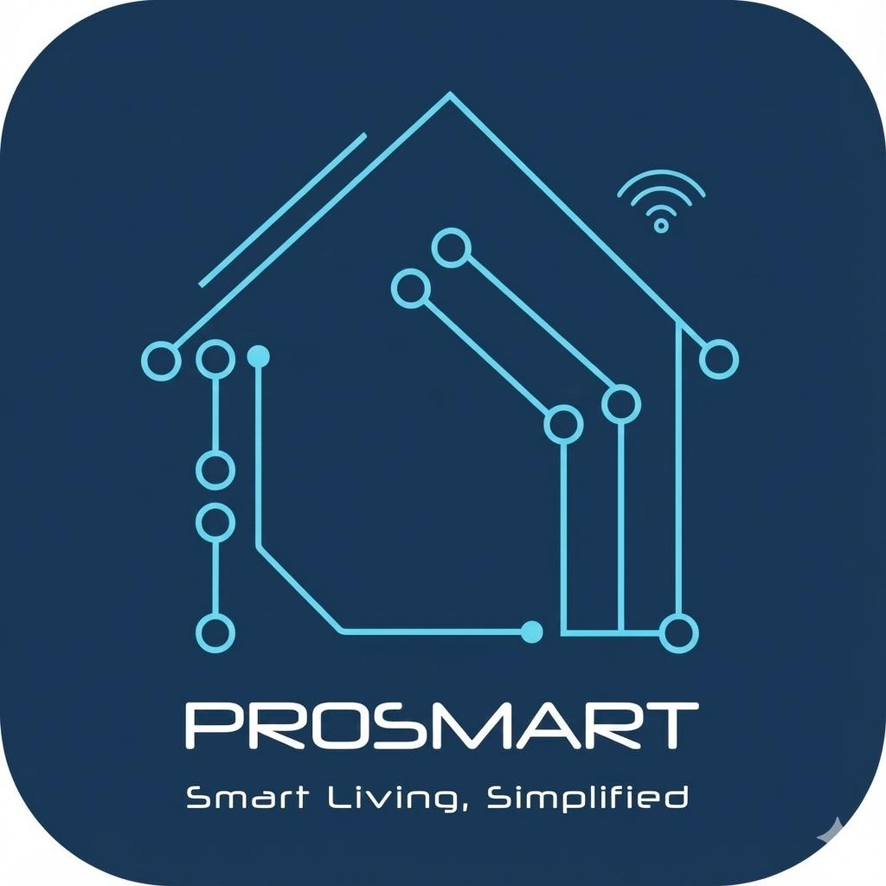

### 🏠 نظام إدارة وتسعير مشاريع المنازل الذكية &nbsp;|&nbsp; Smart Home Projects & Quotation System

**[🇬🇧 English](#en) &nbsp;•&nbsp; [🇪🇬 العربية](#ar)**

---

## 👨‍💻 Developer & Owner — المطوّر وصاحب المشروع

### © MOHAMED IBRAHIM

| | |
|:--|:--|
| 📞 **Phone / الهاتف** | [`01122822813`](tel:+201122822813) |
| ✈️ **Telegram / تليجرام** | [@DIV_MUHAMED](https://t.me/DIV_MUHAMED) |
| 📸 **Instagram / انستجرام** | [mhamed_shsya](https://instagram.com/mhamed_shsya) |
| 💬 **WhatsApp / واتساب** | [@mhamedibrahim](https://wa.me/201122822813) |

**Designed, developed and owned by MOHAMED IBRAHIM**
**تصميم وتطوير وملكية: محمد إبراهيم**

---

# 🇬🇧 English

## 📖 About the Project

**ProSmart** is a professional web system built for smart-home and low-current contractors. It manages the full project cycle in one place: designing rooms and devices, pricing with VAT and discounts, producing client quotations, tracking payments, issuing cash receipts, and analysing costs and expenses.

It replaces scattered spreadsheets and manual paperwork with a fast, organized, bilingual (English / Arabic) workflow.

## ✨ Key Features

| | Feature | Description |
|:-:|:--|:--|
| 🏠 | **Rooms & Devices** | Organize every project by rooms and devices (switches, sensors, cameras, networking and more) |
| 📡 | **Multi-Protocol** | Zigbee, Matter, Wi-Fi, Wired, LAN and KNX |
| 🧾 | **Quotations** | Detailed quotations with pricing, VAT, discounts and version history |
| 💵 | **Payments Tracking** | Record payments by method, with totals and remaining balance |
| 🧷 | **Cash Receipts** *(new)* | Print a receipt per payment: client name, operation number, amount paid and remaining balance |
| 📄 | **PDF & Print** | Export quotations and print price lists |
| 💰 | **Pricing Management** | Price lists, price history and price approval workflow |
| 📊 | **Analytics** | Cost analysis, expenses and monthly charts |
| 📥 | **Excel Import** | Import devices and data from Excel sheets |
| ☁️ | **Google Sheets Backup** | Automatic backup of quotation data |
| 👥 | **Users & Roles** | Admin / User roles with an approval system |
| 🌍 | **Bilingual** | English and Arabic support |

## 🛠️ Tech Stack

- **Frontend:** React 18, TypeScript, Vite, React Router
- **UI:** Tailwind CSS, shadcn/ui, Recharts
- **Backend:** Supabase (PostgreSQL, Auth, Storage, Edge Functions)
- **Documents:** jsPDF, SheetJS (Excel)
- **Deployment:** GitHub Actions → GitHub Pages

## 🖥️ System Sections

| Section | What it does |
|:--|:--|
| 🔐 **Login & Signup** | Secure sign-in with admin approval for new users |
| 🏡 **Home / Quotations** | List, search and manage all client quotations |
| 🧱 **Project Builder** | Rooms, devices, templates and commissioning & installation |
| 🧮 **Pricing & Summary** | Totals, VAT, discounts and cost breakdown |
| 💵 **Payments** | Payment history, balance and cash receipts |
| 📈 **Analytics & Expenses** | Cost analysis, monthly expenses and charts |
| 🛡️ **Admin Panel** | Users, approvals and system settings |

## 📌 Project Status & Updates

| Item | Details |
|:--|:--|
| **Status** | 🟢 Active development |
| **Version** | 1.1 |
| **Last update** | November 2026 |

**Latest updates**
- ✅ **Cash receipt** for every payment (client name, operation number, paid amount, remaining balance), printable or savable as PDF
- ✅ Automatic deployment to GitHub Pages

## ⚖️ Copyright & Ownership

**© 2026 MOHAMED IBRAHIM — All Rights Reserved.**

This project, including its source code, design, structure, logic and documentation, is the exclusive property of **MOHAMED IBRAHIM**.

- ❌ Copying, redistributing, reselling or republishing it, in whole or in part, is **not allowed** without written permission from the owner.
- ❌ **Claiming this project, or any part of it, as your own work, or removing or altering the owner's name and credits, is strictly prohibited.**
- ✅ Any permitted use must keep this notice and the owner's credits visible.

Third-party libraries used in the project remain under their own licenses.

For permissions or business inquiries, contact the owner using the details at the top of this page.

---

# 🇪🇬 العربية

## 📖 نبذة عن المشروع

**ProSmart** نظام ويب احترافي موجّه لمقاولي ومنفّذي المنازل الذكية والتيار الخفيف. بيدير دورة المشروع كلها في مكان واحد: تصميم الغرف والأجهزة، التسعير مع الضريبة والخصومات، إصدار عروض الأسعار للعملاء، متابعة المدفوعات، إصدار وصولات الاستلام النقدية، وتحليل التكاليف والمصروفات.

بيحلّ محل جداول الإكسيل المتفرقة والأوراق اليدوية بعمل سريع ومنظم وثنائي اللغة (عربي / إنجليزي).

## ✨ مميزات النظام

| | الميزة | الوصف |
|:-:|:--|:--|
| 🏠 | **الغرف والأجهزة** | تنظيم كل مشروع بالغرف والأجهزة (مفاتيح، حساسات، كاميرات، شبكات وغيرها) |
| 📡 | **دعم البروتوكولات** | Zigbee وMatter وWi-Fi وWired وLAN وKNX |
| 🧾 | **عروض الأسعار** | عروض تفصيلية بالأسعار والضريبة والخصومات وسجل الإصدارات |
| 💵 | **متابعة المدفوعات** | تسجيل الدفعات بطرق الدفع المختلفة مع الإجمالي والمتبقي |
| 🧷 | **وصل استلام نقدية** *(جديد)* | طباعة وصل لكل دفعة: اسم العميل، رقم العملية، المبلغ المدفوع والمتبقي |
| 📄 | **PDF والطباعة** | تصدير عروض الأسعار وطباعة قوائم الأسعار |
| 💰 | **إدارة الأسعار** | قوائم الأسعار وسجل التغييرات ونظام اعتماد الأسعار |
| 📊 | **التحليلات** | تحليل التكاليف والمصروفات ورسوم شهرية |
| 📥 | **استيراد Excel** | استيراد الأجهزة والبيانات من ملفات إكسيل |
| ☁️ | **نسخ احتياطي Google Sheets** | نسخ احتياطي تلقائي لبيانات العروض |
| 👥 | **المستخدمون والصلاحيات** | أدوار (مدير / مستخدم) مع نظام موافقة |
| 🌍 | **ثنائي اللغة** | دعم العربية والإنجليزية |

## 🛠️ التقنيات المستخدمة

- **الواجهة:** React 18 وTypeScript وVite وReact Router
- **التصميم:** Tailwind CSS وshadcn/ui وRecharts
- **الخادم:** Supabase (قاعدة PostgreSQL والمصادقة والتخزين والـ Edge Functions)
- **المستندات:** jsPDF وSheetJS (إكسيل)
- **النشر:** GitHub Actions ← GitHub Pages

## 🖥️ أقسام النظام

| القسم | وظيفته |
|:--|:--|
| 🔐 **تسجيل الدخول والتسجيل** | دخول آمن مع موافقة المدير على المستخدمين الجدد |
| 🏡 **الرئيسية / العروض** | عرض وبحث وإدارة كل عروض أسعار العملاء |
| 🧱 **بناء المشروع** | الغرف والأجهزة والقوالب والتشغيل والتركيب |
| 🧮 **التسعير والملخص** | الإجماليات والضريبة والخصومات وتفصيل التكلفة |
| 💵 **المدفوعات** | سجل الدفعات والمتبقي ووصلات الاستلام |
| 📈 **التحليلات والمصروفات** | تحليل التكاليف والمصروفات الشهرية والرسوم البيانية |
| 🛡️ **لوحة الإدارة** | المستخدمون والموافقات وإعدادات النظام |

## 📌 حالة المشروع والتحديثات

| البند | التفاصيل |
|:--|:--|
| **الحالة** | 🟢 قيد التطوير النشط |
| **الإصدار** | 1.1 |
| **آخر تحديث** | نوفمبر 2026 |

**آخر التحديثات**
- ✅ **وصل استلام نقدية** لكل دفعة (اسم العميل، رقم العملية، المبلغ المدفوع، المتبقي) قابل للطباعة أو الحفظ PDF
- ✅ نشر تلقائي على GitHub Pages

## ⚖️ حقوق الملكية

**© 2026 محمد إبراهيم (MOHAMED IBRAHIM) — جميع الحقوق محفوظة.**

هذا المشروع بما فيه الكود المصدري والتصميم والهيكل والمنطق والتوثيق ملك حصري لـ **محمد إبراهيم**.

- ❌ يُمنع نسخه أو إعادة توزيعه أو بيعه أو إعادة نشره كليًا أو جزئيًا دون إذن كتابي من المالك.
- ❌ **يُمنع منعًا باتًا نسب المشروع أو أي جزء منه لغير صاحبه، أو إزالة اسم المالك وبياناته أو تعديلها.**
- ✅ أي استخدام مسموح به يجب أن يُبقي هذا الإشعار وبيانات المالك ظاهرة.

المكتبات الخارجية المستخدمة في المشروع تظل تحت تراخيصها الخاصة.

للاستئذان أو التعاقد تواصل مع المالك عبر البيانات الموجودة أعلى الصفحة.

---

**© 2026 MOHAMED IBRAHIM — All Rights Reserved · جميع الحقوق محفوظة**

